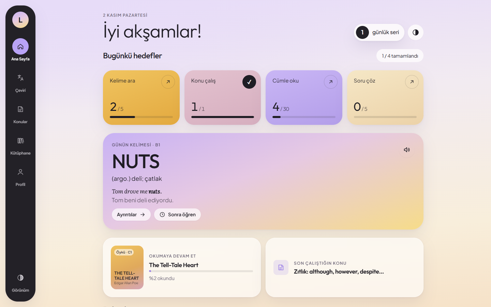
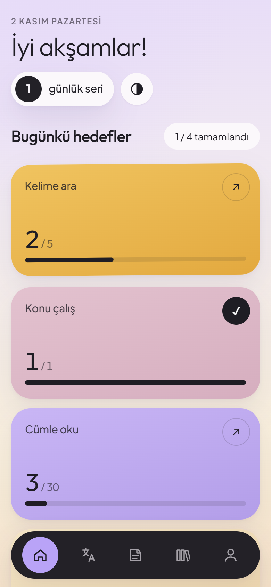
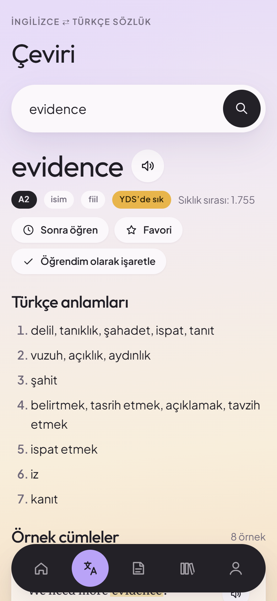
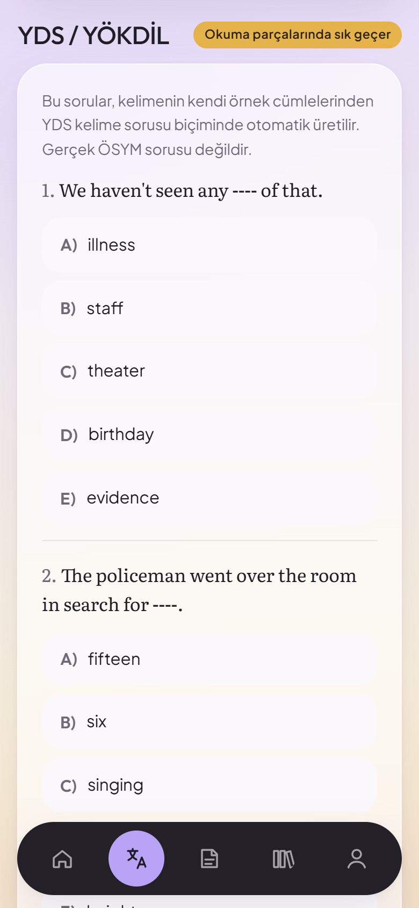
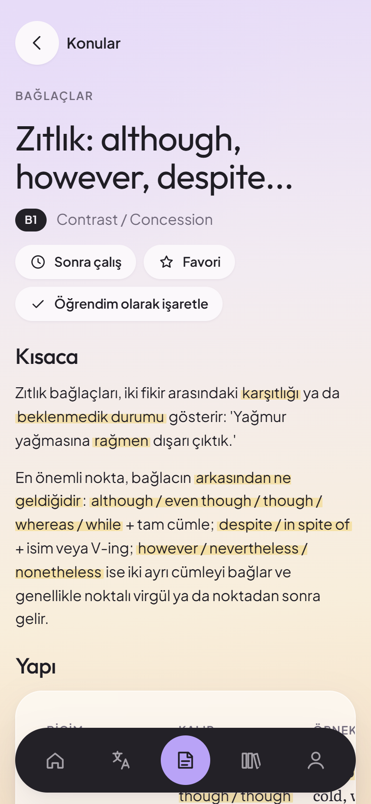
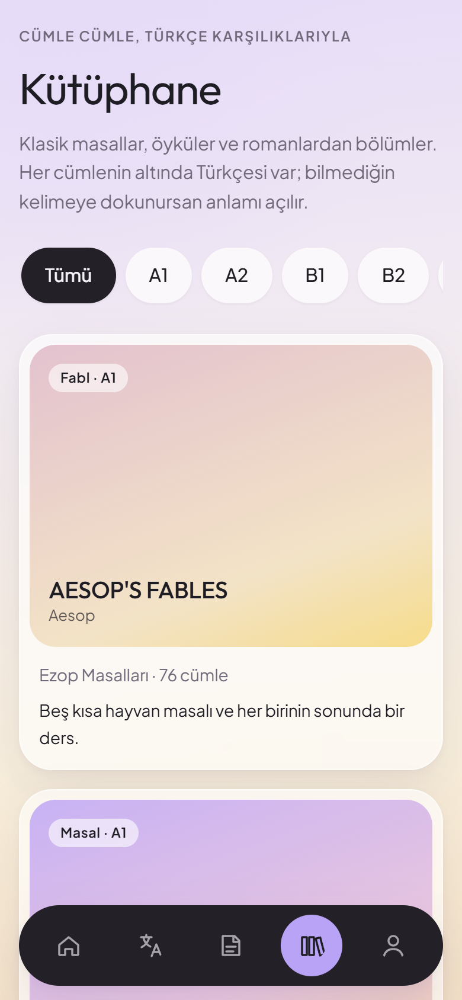
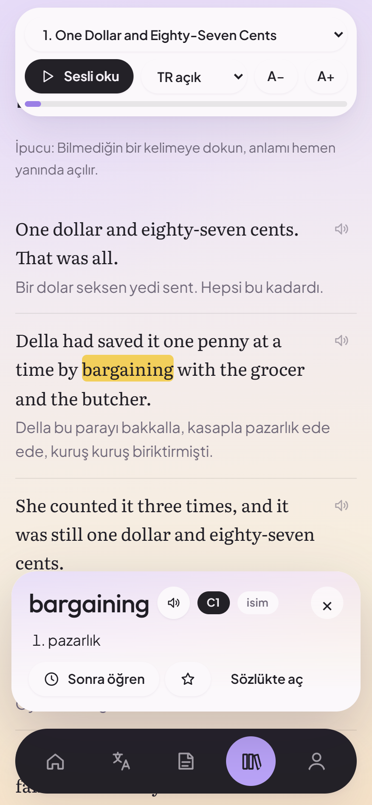
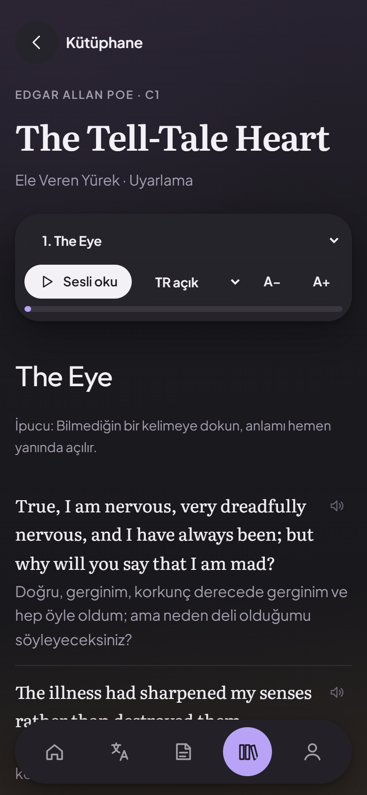
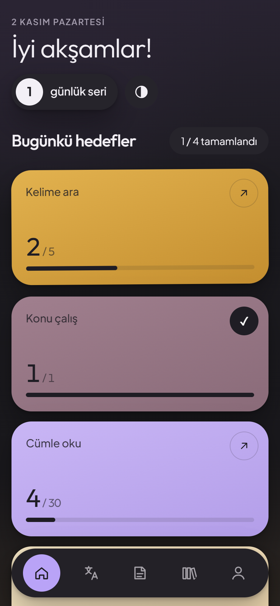

<p align="center">
  
</p>

<h1 align="center">Lugat İngilizce</h1>

<p align="center">
  İnternetsiz çalışan İngilizce–Türkçe sözlük, YDS/YÖKDİL odaklı konu anlatımları<br>
  ve cümle cümle Türkçe karşılıklı klasik kitaplar. Android, iPhone ve tarayıcıda.
</p>

<p align="center">
  <a href="https://github.com/EmreBalcan/lugat-ingilizce/releases/latest/download/Lugat.apk"><b>📱 Android uygulamasını indir</b></a>
  &nbsp;·&nbsp;
  <a href="https://emrebalcan.github.io/lugat-ingilizce/"><b>🌐 Tarayıcıda aç</b></a>
</p>

<p align="center">
  
</p>

## Ne işe yarar?

Lugat, İngilizce çalışırken ihtiyaç duyulan üç şeyi tek uygulamada toplar: kelimeye bakmak, dilbilgisi konusunu çalışmak ve gerçek bir metin okumak. Özellikle YDS ve YÖKDİL'e hazırlananlar için tasarlandı.

Uygulamadaki her cevap kendi içindeki veriden gelir. Bir kelime aradığınızda ya da bir konu açtığınızda hiçbir yapay zekâ servisine veya dış sunucuya istek gitmez. Bu yüzden internet olmadan da çalışır.

## Ekran görüntüleri

<table>
  <tr>
    <td align="center"><br><sub><b>Ana sayfa</b>: günlük hedefler, seri, günün kelimesi</sub></td>
    <td align="center"><br><sub><b>Çeviri</b>: anlamlar, seviye, YDS etiketi</sub></td>
    <td align="center"><br><sub><b>YDS tarzı sorular</b>: kelimenin kendi örneklerinden</sub></td>
  </tr>
  <tr>
    <td align="center"><br><sub><b>Konu anlatımı</b>: yapı, kullanım, 10+ örnek</sub></td>
    <td align="center"><br><sub><b>Kütüphane</b>: A1'den C1'e 19 eser</sub></td>
    <td align="center"><br><sub><b>Okuyucu</b>: kelimeye dokun, anlamı yanında açılsın</sub></td>
  </tr>
  <tr>
    <td align="center"><br><sub><b>Koyu tema</b>: okuyucu</sub></td>
    <td align="center"><br><sub><b>Koyu tema</b>: ana sayfa</sub></td>
    <td></td>
  </tr>
</table>

## İndir

<table>
  <tr>
    <td align="center" width="50%">
      <br>
      <b>Android uygulaması</b><br>
      <sub>Telefonun kamerasıyla okut ya da <a href="https://github.com/EmreBalcan/lugat-ingilizce/releases/latest/download/Lugat.apk">buradan indir</a></sub>
    </td>
    <td align="center" width="50%">
      <br>
      <b>iPhone ve tarayıcı</b><br>
      <sub>Okut ya da <a href="https://emrebalcan.github.io/lugat-ingilizce/">buradan aç</a></sub>
    </td>
  </tr>
</table>

- **Android:** APK'yı indirip açın. Telefon "bilinmeyen kaynaklardan yükleme" izni isterse tarayıcınıza izin verin. Güncellemeler eski sürümün üstüne kurulur, ilerlemeniz silinmez.
- **iPhone:** Bağlantıyı Safari'de açın, **Paylaş → Ana Ekrana Ekle**'ye dokunun. Uygulama simgesiyle tam ekran açılır. İnternetsiz kullanmak için Profil → Ayarlar → **Sözlüğü indir**.
- **Bilgisayar:** Bağlantıyı herhangi bir tarayıcıda açmanız yeterli.

## Özellikler

**Çeviri**
- 40.534 İngilizce kelime ve 67.366 Türkçe arama anahtarıyla iki yönlü sözlük
- Her kelimede Türkçe anlamlar, Tatoeba'dan çevirili örnek cümleler (en sık 3.000 kelimenin hepsinde en az 5), eş ve zıt anlamlılar, İngilizce tanımlar
- **Kullanım biçimi:** kelimenin en sık birlikte kullanıldığı edatlar (*interested in*) ve cümle kalıpları (*Somebody gives up something*)
- Çekimli biçimden köke ulaşma: *went* → go, *studies* → study, *children* → child
- Tahmini seviye (A1–C2), YDS'de sık geçen kelime etiketi, sesli telaffuz
- Kelimenin kendi örnek cümlelerinden üretilen 5 şıklı YDS tarzı sorular

**Konu anlatımı**
- 6 kategoride 26 konu: Zamanlar, Modallar, Cümle Yapıları, Bağlaçlar, Edatlar, Kelime Bilgisi
- Her konuda kısa anlatım, yapı tablosu, kullanım yerleri, **en az 10 çevirili örnek**, dikkat edilecek noktalar
- "YDS/YÖKDİL'de bu konu nasıl çıkar?" açıklaması ve açıklamalı alıştırma soruları

**Kütüphane**
- A1'den C1'e 19 eser, 1.131 cümle: Ezop, Grimm, Andersen, Oscar Wilde, O. Henry, Maupassant, Poe ve diğerleri
- Her cümlenin altında hikâye diliyle yazılmış Türkçe karşılığı; açık, dokununca göster ya da kapalı
- Kelimeye dokununca yanında açılan sözlük kartı ve "sonra öğren" listesine ekleme
- Bölümü sesli okuma: okunan cümle vurgulanır, sayfa kendiliğinden kayar

**Profil**
- Sonra öğren, favoriler ve öğrenilenler (kelime ve konu ayrı)
- Okunan ve bitirilen kitaplar, son 7 günün çalışma grafiği, günlük seri
- Ayarlanabilir günlük hedefler ve kartlarla kelime tekrarı
- Açık, koyu ya da cihaza uyan görünüm

## Kullanılan teknolojiler

| Katman | Teknoloji |
|---|---|
| Arayüz | Saf HTML, CSS ve JavaScript (ES modülleri). Çerçeve veya derleme adımı yok |
| Mobil uygulama | [Capacitor 6](https://capacitorjs.com/): aynı web kodundan yerel Android uygulaması |
| Sesli okuma | Tarayıcıda Web Speech API; Android'de [Capacitor Text-to-Speech](https://github.com/capacitor-community/text-to-speech) eklentisi |
| İnternetsiz çalışma | Android'de tüm veriler APK içinde; web'de Service Worker ve Web App Manifest (PWA) |
| Sözlük motoru | Node.js ile yazılmış derleyici. Kaynakları birleştirip 160 parçalı JSON dosyalarına böler, uygulama yalnızca gereken parçayı yükler |
| Derleme ve yayın | GitHub Actions: her güncellemede imzalı APK derlenir ve web sürümü GitHub Pages'e yayınlanır |
| Test | jsdom ile arayüz etkileşim testleri, Puppeteer ile ekran görüntüleri |
| Yazı tipleri | Outfit, Plus Jakarta Sans, Literata (Google Fonts) |

### Mimari

```
tools/build-dict.mjs   FreeDict + Wiktionary + WordNet + Tatoeba  →  www/data/dict/  (parçalı JSON)
tools/build-content.mjs konu ve kitap dosyaları                    →  dizinler, PWA servis çalışanı
www/                    uygulamanın kendisi (index.html, css, js, data)
android/                Capacitor Android projesi
.github/workflows/      APK derleme ve GitHub Pages yayını
```

## Veri kaynakları

| Kaynak | Ne için | Lisans |
|---|---|---|
| [FreeDict eng-tur](https://freedict.org/) | Türkçe anlamlar | GPL |
| [Wiktionary](https://www.wiktionary.org/) ([kaikki.org](https://kaikki.org/) dökümü) | Türkçe→İngilizce arama, ek anlamlar | CC BY-SA |
| [Princeton WordNet 3.1](https://wordnet.princeton.edu/) | Tanımlar, eş/zıt anlamlılar, cümle kalıpları | WordNet lisansı |
| [Tatoeba](https://tatoeba.org/) ([manythings.org](https://www.manythings.org/anki/) derlemesi) | İngilizce–Türkçe örnek cümleler | CC BY 2.0 FR |

Konu anlatımları ve kitap uyarlamaları bu proje için yazılmıştır. Kitaplar telif süresi dolmuş eserlerin seviyeye göre yeniden anlatımıdır. Uygulamadaki YDS/YÖKDİL soruları sınav biçiminde hazırlanmış alıştırmalardır, ÖSYM'nin yayımladığı sorular değildir.

## Geliştirme

```bash
npm install
npm run build:dict      # sözlüğü kaynaklardan yeniden üretir (kaynaklar tools/raw/ altına indirilmelidir)
npm run build:content   # konu/kitap dizinlerini ve servis çalışanını üretir
npx cap sync android    # web dosyalarını Android projesine kopyalar
```

`www/` klasörünü herhangi bir statik sunucuyla açarak uygulamayı yerelde çalıştırabilirsiniz.
